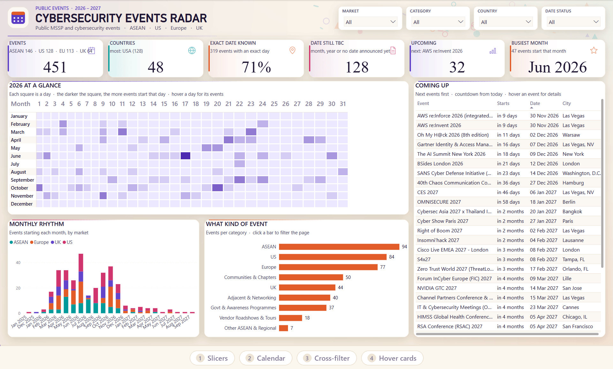

# Cybersecurity Events Radar 2026–2027 (Power BI + Excel)

A calendar of **451 public cybersecurity events** in **48 countries** (ASEAN, the US, Europe and the UK), built twice:
a one-page Power BI dashboard and an Excel workbook. Free-text dates such as "Q3 2026 (TBC)" are parsed into a
precision level (day, month, year or none) before anything goes on a calendar.

## What's inside
**Power BI**
- **2026 month × day heatmap** of event start dates.
- **Monthly rhythm by market** and **event categories**.
- **"Coming up" agenda** with a live countdown column.
- KPI tiles, including the busiest month and the next event. Slicers in the header, click-to-cross-filter, and a
  hover card for each event.

**Excel** ([`data/Cybersecurity_Events_Radar.xlsx`](data/Cybersecurity_Events_Radar.xlsx))
- **Calendar:** a 12-month × 31-day `COUNTIFS` heatmap with Year and Market drop-downs.
- **Agenda:** one `LET` / `FILTER` / `SORTBY` / `CHOOSECOLS` formula lists a month's events, sorted by date.
- **Dashboard:** headline numbers, events per month by market, by category and by date precision.
- Recalculated in Excel and checked against Python (all 372 calendar cells, the agenda, every dashboard number):
  0 mismatches, 0 formula errors.

## How it's built
- Two research workbooks (ASEAN 146 events, Global 305) are combined into [`data/events.csv`](data/events.csv):
  public information only, each event with its source URL and verification status.
- Only exact days go on the calendar grid (319 events). 128 events are flagged **TBC / Undated** instead of being
  placed on a guessed date.
- Power Query reads `events.csv` straight from this repository, turns blanks into nulls before typing, and links
  events to a date table. The 1920×1080 background artboard and theme are generated in Python.

## Open it
- Open `powerbi/CybersecurityEventsRadar.pbip` in Power BI Desktop and choose **Anonymous** when asked how to connect
  to `raw.githubusercontent.com`.
- Or open the Excel workbook (Microsoft 365 / Excel 2024).
- Dates change: check the source link before relying on any single event.

**Tools:** Power BI (PBIP), Power Query (M), DAX, Excel (COUNTIFS, LET, FILTER, SORTBY, CHOOSECOLS), Python · built
with Claude Code as a coding assistant
