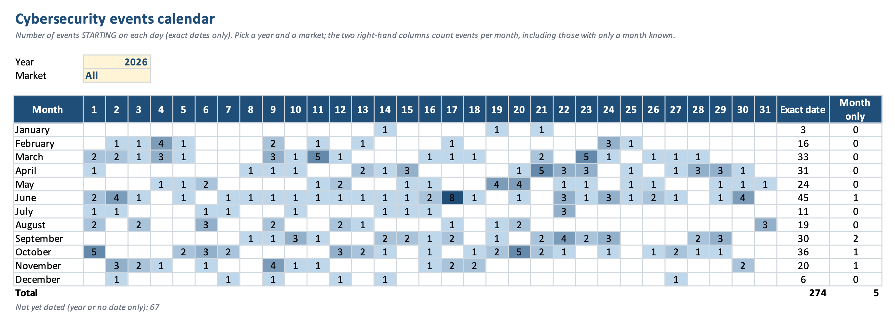
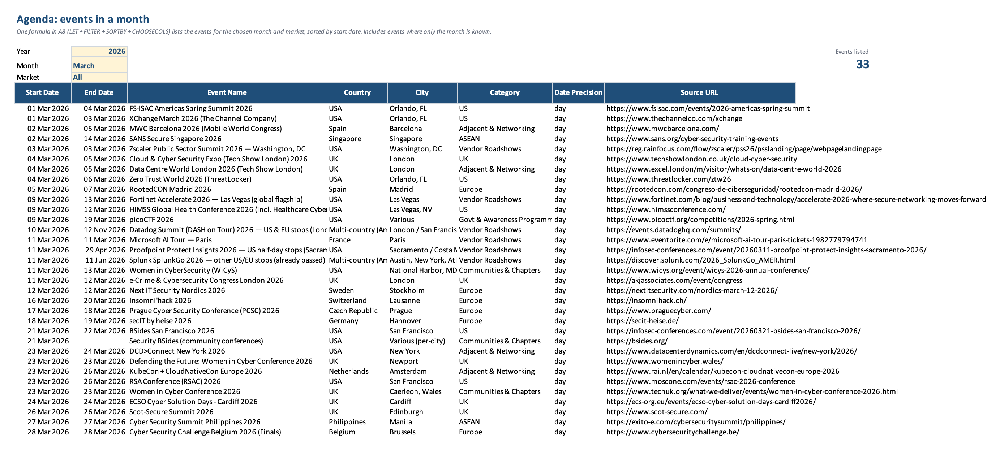
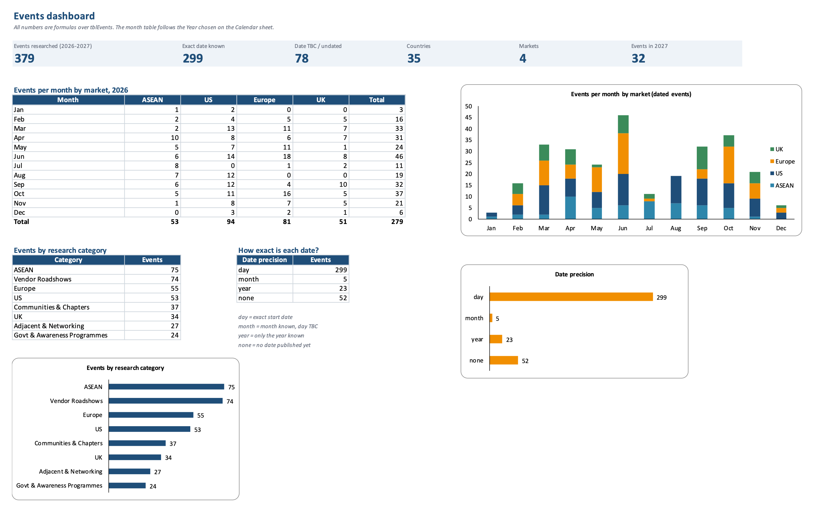

# Cybersecurity Events Calendar 2026–2027

A calendar of **379 public cybersecurity events** across ASEAN, the US, Europe and the UK: conferences, vendor
roadshows, government awareness programmes and community chapters. It's built twice:

- **Excel workbook:** a calendar heatmap, a one-formula agenda and a dashboard, verified against Python with
  0 mismatches.
- **Power BI project:** with its own date table and four report pages.

Most source dates were free text such as "Q3 2026 (TBC)", so every date is parsed into a **precision level** before
it goes on a calendar.



**Built with:** Excel (Microsoft 365): COUNTIFS, EOMONTH, LET, FILTER, SORTBY, CHOOSECOLS, UNIQUE, data validation,
colour scales. Power BI: Power Query (M) date table, DAX measures, PBIP. Python for data preparation and
verification.

---

## The data problem: dates you can't put on a calendar

Event dates were collected from official sites and listings, and written down as found: `21-24 Apr 2026`,
`Mar 2026`, `2026 (dates TBC)`, or nothing yet. Every start date is parsed into:

| Precision | Meaning | Events |
|---|---|---|
| **day** | exact start date | 299 |
| **month** | month known, day TBC | 5 |
| **year** | only the year known | 23 |
| **none** | no date published yet | 52 |

Only exact days go on the calendar grid. Month-only events are counted per month, and undated events are listed
separately rather than placed on a guessed date. Each event also keeps its market, category, organiser, audience
scale, source URL and verification note.

**Scope:** 380 events collected; 379 kept (2026 onwards) across 35 countries and 4 markets.

## Excel version

Three views over one Excel Table (`tblEvents`):

- **Calendar:** a 12-month × 31-day heatmap of events starting each day, with **Year** and **Market** drop-downs.
  Each cell is a `COUNTIFS`, and impossible dates (30 Feb) are blanked with `EOMONTH`.
- **Agenda:** choose a year, month and market, and **one formula** lists that month's events, sorted by date:

```excel
=LET(y, $B$4,  m, MATCH($B$5, {"January", ..., "December"}, 0),  mk, $B$6,  d, tblEvents[Start Date],
     keep, (YEAR(d) = y) * (MONTH(d) = m) * (((tblEvents[Market] = mk) + (mk = "All")) > 0) * (d <> ""),
     raw,  CHOOSECOLS(tblEvents, XMATCH({"Start Date","End Date","Event Name","Country","City",
                                         "Category","Date Precision","Source URL"}, tblEvents[#Headers])),
     cols, IF(raw = "", "", raw),
     IF(SUM(keep) = 0, "No events for this selection", SORTBY(FILTER(cols, keep), FILTER(d, keep), 1)))
```

- **Dashboard:** headline numbers, events per month by market, events by category, and date precision.




**Verified:** the workbook was recalculated in Excel and checked against Python for the default view (2026, all
markets). All 372 calendar cells, the monthly totals, the agenda (row count and sort order) and every dashboard
number match, with no formula errors.

## Power BI version

[`powerbi/CyberEventsCalendar.pbip`](powerbi/): a Power BI Project (model, Power Query and report saved as text
files).

- **Model:** `Events` linked to a **`Date` table** on start date. The date table is built in Power Query for
  2026–2027 and marked as the model's date table, with month and weekday columns sorted by number.
- **Power Query:** reads the workbook, adds an event ID and a readable precision label, and types every column.
- **Measures:** Events, Events With Exact Date, Events Date TBC, Exact Date %, Countries, Events Starting.
- **Pages:** **Calendar** (month × day matrix with a colour scale), **Overview** (KPIs, events per month by market,
  categories), **Event List** (filter by market, category or country), **Dates & Data Quality** (precision mix and
  a filtered table of undated events).

```m
// Date table (Power Query)
Dates   = List.Dates(#date(2026, 1, 1), Duration.Days(#date(2027, 12, 31) - #date(2026, 1, 1)) + 1, #duration(1, 0, 0, 0)),
AsTable = Table.FromList(Dates, Splitter.SplitByNothing(), {"Date"}),
AddYearMonth = Table.AddColumn(..., "Year Month", each Date.ToText([Date], [Format = "MMM yyyy", Culture = "en-GB"]), type text)
```

*Report screenshots will be added once the report is published.*

## Data

Public event information. The data file itself is not included in this repository.
